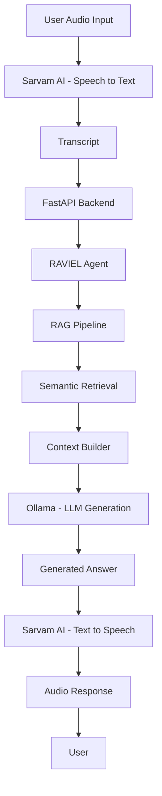
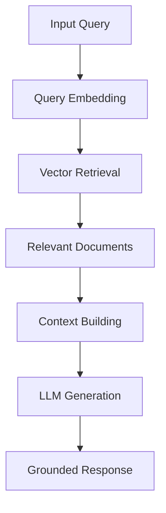

# RAVIEL
### Voice-Enabled Retrieval-Augmented Generation Assistant

RAVIEL is a multilingual, voice-enabled AI assistant built using **Retrieval-Augmented Generation (RAG)**. It combines speech recognition, semantic search, context-aware response generation, and speech synthesis to provide conversational answers grounded in retrieved information.

The project integrates **Sarvam AI, Jina Embeddings, FastAPI, and Ollama** to create a voice-to-voice AI experience.

---

## Overview

Traditional conversational AI systems can generate responses without reliable supporting evidence. RAVIEL addresses this limitation through a retrieval-based architecture that retrieves relevant information before generating an answer.

Users can interact with RAVIEL through:

- **Text:** Submit a question and receive a context-grounded answer.
- **Voice:** Submit an audio recording, convert speech to text, retrieve relevant information, generate an answer, and convert the response back into speech.

The system is designed with multilingual interaction in mind, including support for Indian languages through its speech-processing components.

---

## Key Features

- **Voice-to-Voice Interaction:** Converts incoming audio into text and generates spoken responses.
- **Retrieval-Augmented Generation:** Retrieves relevant context before generating answers.
- **Semantic Search:** Uses Jina embeddings for semantic representation of text.
- **Multilingual Speech Processing:** Integrates Sarvam AI for speech recognition and synthesis.
- **Context-Grounded Responses:** Generates answers using retrieved information.
- **Abstention Handling:** Supports responses when sufficient evidence is unavailable.
- **REST API:** Exposes endpoints through FastAPI.
- **Latency Tracking:** Measures retrieval, context-building, generation, and overall pipeline execution time.
- **Interactive Frontend:** React-based frontend built with Vite.

---

## System Architecture

### Voice Processing Pipeline



### RAG Pipeline



---

## Technology Stack

| Component | Technology |
|---|---|
| Backend | Python, FastAPI |
| Frontend | React, Vite |
| Language Model | Ollama |
| Default LLM | Qwen 2.5 0.5B Instruct |
| Embeddings | Jina Embeddings v3 |
| Speech-to-Text | Sarvam AI Saaras v3 |
| Text-to-Speech | Sarvam AI Bulbul v3 |
| Vector Storage | In-memory vector store |
| API Communication | REST |
| Testing | Pytest |

---

## Repository Structure

```text
RAVIEL/
│
├── api/
│
├── backend/
│   ├── api/
│   │   ├── app.py
│   │   └── models.py
│   │
│   ├── chunking/
│   ├── embeddings/
│   ├── generation/
│   ├── indexing/
│   ├── ingestion/
│   ├── orchestration/
│   ├── retrieval/
│   ├── voice/
│   │
│   ├── agent.py
│   ├── application.py
│   ├── benchmark.py
│   ├── score_test.py
│   └── service.py
│
├── data/
│
├── docs/
│   ├── DATASET_REFERENCE.md
│   ├── DATA_CONTRACT.md
│   └── PROBLEM_STATEMENT.md
│
├── evaluation/
│
├── frontend/
│   ├── src/
│   ├── package.json
│   └── vite.config.js
│
├── scripts/
│
├── tests/
│
├── pyproject.toml
├── requirements.txt
└── README.md
```

---

## Getting Started

### 1. Prerequisites

Install the following:

- Python 3.11 or higher
- Node.js and npm
- Ollama
- Git

You will also need API credentials for:

- Jina AI
- Sarvam AI

### 2. Clone the Repository

```bash
git clone <YOUR_GITHUB_REPOSITORY_URL>
cd RAVIEL
```

### 3. Create a Python Virtual Environment

**Windows:**

```powershell
python -m venv .venv
.venv\Scripts\activate
```

**Linux/macOS:**

```bash
python -m venv .venv
source .venv/bin/activate
```

### 4. Install Dependencies

```bash
pip install -r requirements.txt
```

### 5. Configure Environment Variables

Create a `.env` file or configure the variables in your environment:

```env
JINA_API_KEY=your_jina_api_key
SARVAM_API_KEY=your_sarvam_api_key
```

Keep your API keys private. Never commit `.env` files or expose credentials publicly.

### 6. Configure Ollama

Install and start Ollama.

Pull the default language model:

```bash
ollama pull qwen2.5:0.5b-instruct
```

Ensure Ollama is running before starting the backend.

### 7. Start the Backend

From the repository root:

```bash
python -m uvicorn backend.api.app:app --reload
```

The API will be available at:

```text
http://127.0.0.1:8000
```

### 8. Start the Frontend

Open another terminal:

```bash
cd frontend
npm install
npm run dev
```

Vite will display the local frontend URL in the terminal.

---

## API Endpoints

RAVIEL exposes the following endpoints through FastAPI.

| Method | Endpoint | Description |
|---|---|---|
| GET | `/health` | Checks API health |
| POST | `/ask` | Accepts a text query and returns an answer |
| POST | `/voice` | Accepts audio and returns a spoken response |

### Health Check

```http
GET /health
```

Example response:

```json
{
  "status": "ok",
  "service": "RAVIEL"
}
```

### Text Query

```http
POST /ask
```

Request:

```json
{
  "query": "What is artificial intelligence?"
}
```

### Voice Query

```http
POST /voice
```

Submit an audio file using multipart form data with the field name:

```text
file
```

The endpoint processes the audio and returns a WAV audio response.

### Interactive API Documentation

Once the backend is running, access:

- Swagger UI: `http://127.0.0.1:8000/docs`
- ReDoc: `http://127.0.0.1:8000/redoc`

---

## Testing

The repository includes Pytest-based tests covering multiple components of the system.

Run the test suite from the repository root:

```bash
pytest
```

For detailed output:

```bash
pytest -v
```

---

## Performance and Monitoring

RAVIEL includes pipeline-level latency tracking.

The orchestration layer measures:

- Retrieval latency
- Context-building latency
- Generation latency
- Total pipeline latency

It also maintains latency statistics, including:

- P50
- P70
- P100
- Minimum latency
- Mean latency

These measurements help identify performance bottlenecks across the RAG pipeline.

Actual benchmark results should be reported only after running the evaluation under documented conditions.

---

## Current Implementation Notes

- The current vector store is in-memory.
- The application initializes its index using a sample dataset of up to 20 records.
- Embedding generation uses the external Jina API.
- Speech processing uses the external Sarvam AI API.
- Language generation uses a locally hosted Ollama model.
- Pipeline latency history is maintained in memory.

These are current implementation characteristics, not claims of production-scale deployment.

---

## Future Improvements

Potential development directions include:

- Persistent vector database integration.
- Hybrid retrieval using dense and sparse search.
- Improved reranking strategies.
- Expanded multilingual evaluation.
- Better conversational memory.
- More comprehensive hallucination and safety evaluation.
- Optimized end-to-end voice latency.
- Production deployment and scalability improvements.

---

## Project Information

**Project:** RAVIEL  
**Category:** Voice AI | Retrieval-Augmented Generation | Multilingual AI  
**Backend:** FastAPI  
**Frontend:** React + Vite  
**LLM Runtime:** Ollama  

---

*RAVIEL explores how speech interfaces, semantic retrieval, and grounded language generation can work together to create more useful and reliable AI assistants.*
